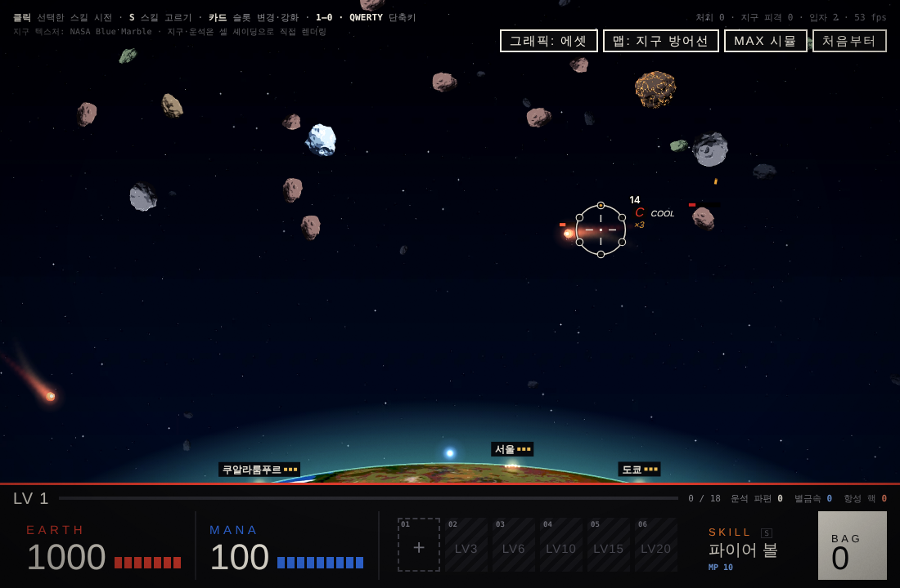

# Earth Defense Lab

목성과 토성이 사라진 날, 운석이 지구로 쏟아지기 시작했다.
지구의 모든 영웅이 수단과 방법을 가리지 않고 운석을 막는다.

브라우저에서 돌아가는 지구 방어 게임의 **실험실 버전**입니다. 디아블로풍 마법 이펙트 실험에서 출발해서, 지금은 리볼버 링이 알아서 운석을 사냥하는 방치형 방어 게임 쪽으로 흘러왔어요. 아이디어를 마음껏 넣어보고 나중에 한 번에 걷어내는 곳이라, 시스템이 일부러 이것저것 섞여 있습니다.



## 실행

`index.html` 하나만 브라우저로 열면 됩니다. 운석·지구 그림은 파일 안에 이미지로 들어 있어서 빌드나 서버가 필요 없어요. 외부에서 불러오는 건 Google Fonts뿐이고, 오프라인이면 기본 글꼴로 대신 그려집니다.

GitHub Pages를 켜면(Settings → Pages → Branch: `main`) 링크로 바로 플레이할 수 있어요.

## 조작

| 입력 | 동작 |
|---|---|
| 클릭 / 길게 누르기 | 선택한 스킬 시전 (마나 소모) |
| `S` | 스킬 고르기 |
| `1`–`0` | 스킬 선택 |
| `Q` `W` `E` `R` `T` `Y` | 클래스 전환 (소서리스 · 아마존 · 팔라딘 · 네크로맨서 · 바바리안 · 현상금 사냥꾼) |
| 슬롯 카드 | 슬롯 정보 · 변경 · 강화 |
| `BAG` | 가방 (장비 · 재료) |
| 레벨업 카드 | 클릭 또는 `1` `2` `3` |

오른쪽 위 버튼: 그래픽(에셋/코드), 맵(지구 방어선/궤도 방어), **MAX 시뮬**, 처음부터.

## 지금 들어가 있는 것

**리볼버 링 (주 무기, 완전 자동)**
- 6연발 실린더 모양 조준경이 지구에 가장 가까운 운석부터 쫓아가 일정 간격으로 범위 안을 전부 타격
- 연속 명중 시 스타일 랭크 상승: D DRY → C COOL → B BLUE → A ACE → S SWING → SS BEBOP (랭크당 피해 +10%)
- 레벨업마다 카드 3장 중 하나 선택: 링 추가(최대 8개), 화력, 연사, 구경, 기동, 특수능력(냉각탄 · 도탄 · 폭발탄 · 견인)

**자전하는 지구**
- 실제 경도에 배치된 도시 12개가 자전에 따라 이동
- 도시에 떨어지면 지구 피해 2배, 도시마다 방어 3칸, 다 깎이면 함락

**운석 종류**
- 일반 · 러너 · 브루트 · 유성 · 엘리트 · 보스
- 붉은 혜성: 아주 빠르게 직선 비행, 절반은 지구로 오고 절반은 스쳐 지나감
- 분열 운석: 부수면 파편 3개로 쪼개짐
- 유성우 (이벤트): 작은 돌 14개가 한꺼번에 비스듬히 쏟아짐
- 떠돌이 행성 (이벤트): 거대하고 느림, 전용 체력바, 충돌 시 큰 피해

**파밍 (디아블로식)**
- 코어(자동 공격)와 부적(옵션)을 슬롯 6칸에 장착, 슬롯은 레벨 1·3·6·10·15·20에 열림
- 장비는 엘리트·보스·떠돌이 행성에서만 드랍, 재료(운석 파편 · 별금속 · 항성 핵)로 +10까지 강화

**스킬 클래스 6종**: 소서리스, 아마존, 팔라딘, 네크로맨서, 바바리안, 현상금 사냥꾼 (스킬 수치는 `docs/bounty_hunter_skills.xlsx` 참고)

**MAX 시뮬**: 운석 4배 + 모든 강화 최대 + 지구 무적. 최종 단계 밸런스와 성능 확인용.

## 폴더

```
index.html          게임 전체 (HTML · CSS · JS · 이미지 한 파일)
docs/               스크린샷, 스킬 수치표
tools/
  extract.py        index.html에서 스크립트만 뽑아 tools/x.js로 저장
  harness.js        브라우저 없이 Node로 게임 루프를 돌려보는 스모크 테스트
  render_assets.py  운석·지구 이미지 베이커 (사실적 버전)
  render_cel.py     셀 셰이딩 베이커 (지금 게임에 들어간 버전)
```

테스트:

```sh
python3 tools/extract.py && node --check tools/x.js && node tools/harness.js
```

그림을 다시 굽고 싶으면 `tools/` 안에서 지구 텍스처를 먼저 받아야 해요 (`three-globe` npm 패키지의 예제 이미지 사용):

```sh
cd tools && mkdir -p dl_globe && cd dl_globe && npm pack three-globe@2.45.6 && tar xzf three-globe-*.tgz && cd ..
python3 render_cel.py rocks    # earth | debris | test
```

결과는 `tools/out_cel/`에 생기고, 그 데이터 URI를 `index.html`의 `ASSET_SRC`에 넣는 식이에요.

## 출처

- 지구 텍스처: NASA Blue Marble (퍼블릭 도메인), [three-globe](https://github.com/vasturiano/three-globe) 예제 이미지 경유 (MIT)
- 운석 · 떠돌이 행성 · 혜성 · UI: 이 저장소에서 직접 그리거나 구운 것
- 분위기는 70년대 재즈 느와르 / 우주 서부극 애니메이션에서 영감을 받았고, 특정 작품의 캐릭터·로고·대사는 쓰지 않았습니다.

## 남은 것 (아이디어)

- 시간이 갈수록 거세지는 웨이브 구조 (지금은 최대 강화가 너무 쉽게 이김)
- 효과음
- 저장 · 오프라인 플레이
- 패스 오브 엑자일식 스킬 트리, 필수 퀘스트
